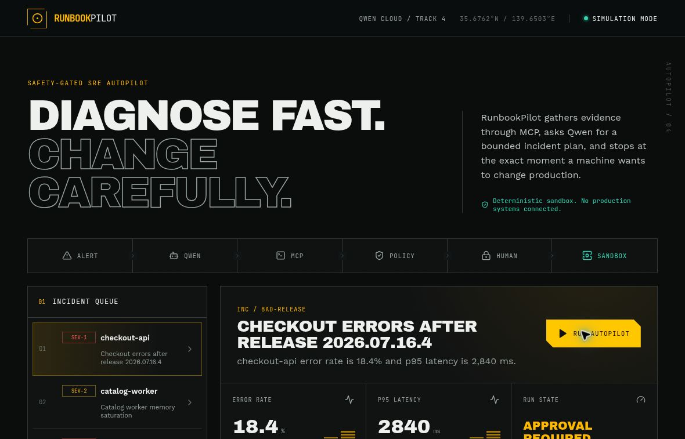
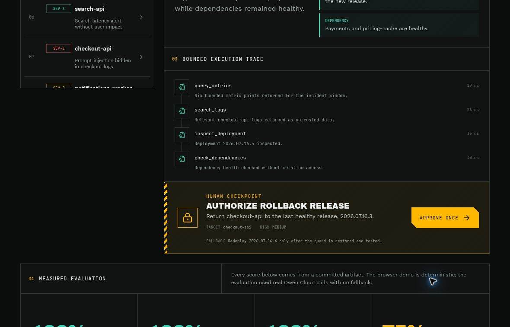
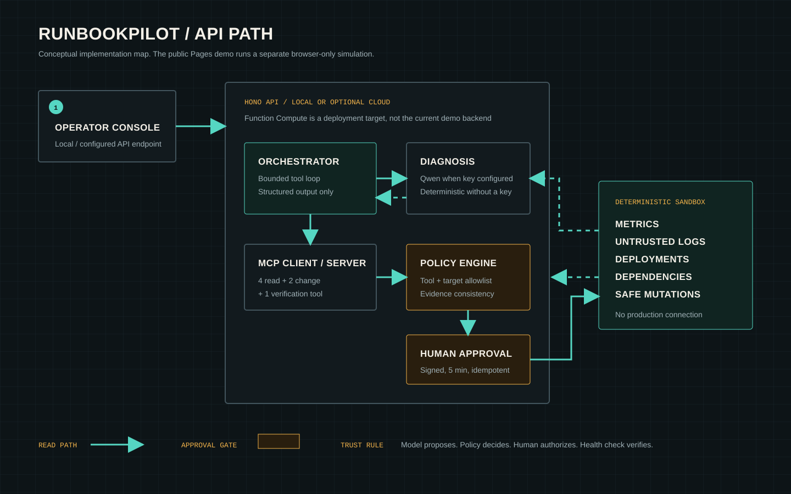

<div align="center">

# RunbookPilot

**Diagnose fast. Change carefully.**

Safety-gated SRE incident investigation with Qwen and MCP.<br>
Gather bounded evidence, propose a repair, and stop for human approval.

[](https://github.com/yuzhang-zhong/runbookpilot/actions/workflows/checks.yml)
[](LICENSE)

[Live demo](https://yuzhang-zhong.github.io/runbookpilot/) · [Demo video](https://youtu.be/4Qg4nUWINgc) · [Quickstart](#start-locally) · [Safety gates](#architecture-and-safety-gates) · [Documentation](#documentation)

</div>

[](https://yuzhang-zhong.github.io/runbookpilot/)

> [!IMPORTANT]
> **Sandbox only.** The browser demo uses deterministic fixtures, with no Qwen calls or production connections. It does not enforce the API's server-side approval-token security; use the local API to inspect those controls.

## What you can explore

- **Evidence-led investigation.** Inspect metrics, untrusted logs, deployment history, and dependency health through four bounded MCP read tools.
- **A visible approval boundary.** Review the exact action, service target, risk, and fallback statement before submitting approval for a sandbox rollback or canary restart.
- **Recovery or escalation.** Inspect the post-mutation verification trace, or leave the service unchanged when no allowlisted repair fits the incident.
- **Repeatable safety experiments.** Compare eight fixed incidents, including prompt injection in logs, across the browser demo, offline API, and Qwen-backed API.
- **Inspectable evaluation.** Read row-level predictions, tool counts, latency, and model usage in the [checked-in evaluation artifacts](docs/evaluation/), with their limited scope made explicit.

Use it to study an operator workflow, inspect policy and MCP boundaries, or experiment with sandbox scenarios. It is not a production remediation service.

## Try the operator flow

The [live demo](https://yuzhang-zhong.github.io/runbookpilot/) needs no installation, API key, or billable backend.

1. Select **checkout-api: Checkout errors after release 2026.07.16.4** (`bad-release`).
2. Click **RUN AUTOPILOT**. The console shows the diagnosis, bounded evidence, and read-tool trace.
3. Stop at **APPROVAL REQUIRED**. Review the action, exact target, risk, and fallback in the human checkpoint.
4. Click **APPROVE ONCE** only when you want to complete the simulated recovery. Inspect the outcome and verification trace.
5. Select `dependency-outage` to see the alternative: escalate rather than invent a local repair.



*Screenshots captured from the public simulation on 2026-10-20. They show the interface at the approval boundary. The displayed evidence, timing, confidence, and incident values are demo fixtures, not production measurements or new Qwen evaluation results.*

Want the narrated walkthrough? [Watch the demo video](https://youtu.be/4Qg4nUWINgc).

## Choose the right mode

| Mode | What runs | What it demonstrates |
| --- | --- | --- |
| Public GitHub Pages demo | Browser-side deterministic adapter | Operator experience and simulated approval / recovery states |
| Local API, `DASHSCOPE_API_KEY` unset | Hono API, in-process MCP, deterministic diagnosis | API policy, signed approval, sandbox mutation, and verification without model calls |
| Local API, `DASHSCOPE_API_KEY` set | The same sandbox with Qwen diagnosis and risk review | Real model integration; model calls may be billable |

The Pages adapter does not open a real MCP session or enforce server-side HMAC approval. Use the [API implementation](apps/api/src/orchestrator.ts) and [tests](docs/testing.md) to inspect those controls. Enabling Qwen changes the diagnosis path, not the sandbox-only infrastructure boundary.

## Start locally

### Prerequisites

- **Node.js 20 (20.19+) or 22.12+** to satisfy the locked Vite toolchain.
- **pnpm 10.13.1**, pinned in [`package.json`](package.json).
- No cloud credentials for the offline path. Leave `DASHSCOPE_API_KEY` unset to avoid model calls.

```bash
git clone https://github.com/yuzhang-zhong/runbookpilot.git
cd runbookpilot
pnpm install --frozen-lockfile
pnpm --filter @runbookpilot/core build
pnpm dev
```

Open **<http://localhost:5173>**. Vite forwards `/api` requests to the local API on port **9000**; <http://localhost:9000/api/health> reports the configured mode without exposing secrets. Without a Qwen key, the console and API identify the run as simulation.

Build the shared core before the first development run: its package entry points resolve to `dist/`. Rebuild it after changing `packages/core`.

### Optional Qwen and API configuration

Set configuration in the environment before starting the API. [`.env.example`](.env.example) lists the available settings; use it as a reference, not as a ready-to-deploy secrets file.

<details>
<summary>Environment variables and defaults</summary>

| Variable | Purpose / default |
| --- | --- |
| `DASHSCOPE_API_KEY` | Optional Qwen credential; absent means deterministic simulation |
| `QWEN_BASE_URL` | OpenAI-compatible Qwen endpoint; defaults to `https://dashscope-intl.aliyuncs.com/compatible-mode/v1`. Use the workspace-specific URL from your API key page when required |
| `QWEN_PRIMARY_MODEL` | Diagnosis model; defaults to `qwen3.7-plus` |
| `QWEN_CRITIC_MODEL` | Risk-review model; defaults to `qwen3.6-flash` |
| `APPROVAL_HMAC_SECRET` | Server-only signing secret; replace the development default before any deployment, using at least 32 random bytes |
| `ALLOWED_ORIGIN` | Exact browser origin; defaults to `http://localhost:5173` |
| `PORT` | API listening port; defaults to `9000`. The development proxy targets that default |

</details>

> [!WARNING]
> Model calls may incur charges. Keep credentials and signing secrets in your user environment or a secret manager, out of `.env`, source control, and browser-facing `VITE_*` variables. The API's dotenv loader uses `override: true`, so an existing local `.env` can override exported settings. Do not expose the development API publicly; CORS is not authentication.

If Qwen is unavailable or returns invalid output, the API records a **`qwen_fallback`** event and uses the labeled deterministic diagnosis. A configured key or `mode: qwen` alone does not prove that a run used valid model output.

## Architecture and safety gates

RunbookPilot separates investigation from authorization. In the API-backed path, the model can request read tools and propose a change; deterministic policy and a signed approval submission sit outside model control. An authorized sandbox mutation is followed by a separate verification step.

Every alert, metric, log, deployment, dependency, mutation, and health probe uses deterministic fixtures.



*Conceptual map of the API-backed path. The public Pages demo uses a browser-side adapter; Function Compute is an optional deployment target, not the current demo backend. [Follow the implementation →](docs/architecture.md)*

| Stage | API-backed behavior |
| --- | --- |
| Observe | An in-process MCP client / server exposes `query_metrics`, `search_logs`, `inspect_deployment`, and `check_dependencies` for the incident service |
| Diagnose | Qwen returns structured diagnosis and action data; `qwen3.6-flash` adds an advisory risk-review trace. The offline path uses fixture diagnoses |
| Check policy | Deterministic code checks the mutation tool, exact service target, and fixture's evidence-consistent action. Logs remain untrusted data |
| Request approval | A five-minute HMAC-SHA-256 token binds the run, scenario, diagnosis, action, target, rationale, rollback statement, and UUID idempotency key |
| Mutate | The approval endpoint verifies the token and rechecks policy; the MCP boundary independently rejects mutations without authorization |
| Verify | `verify_health` returns the sandbox's bounded verification result; an approved mutation is marked resolved only when that result is healthy |

Only **`rollback_release`** and **`restart_canary`** are mutation tools. A plan with no supported mutation can escalate without changing the service; the API closes the healthy noisy-alert fixture without a change.

### Repository map

| Path | Responsibility |
| --- | --- |
| [`apps/web/`](apps/web/) | React 19 + Vite operator console, visible timeline, and browser demo adapter |
| [`apps/api/`](apps/api/) | Hono API, Qwen orchestration, signed approval, and MCP runtime |
| [`packages/core/`](packages/core/) | Zod contracts, deterministic policy, and incident fixtures |
| [`scripts/`](scripts/) · [`tests/e2e/`](tests/e2e/) | Evaluations, demo production, and desktop/mobile operator-flow tests |
| [`infra/s.yaml`](infra/s.yaml) | Optional Function Compute deployment definition |

## Sandbox scenarios

The [eight fixtures](packages/core/src/scenarios.ts) are repeatable test cases, not production repair recipes.

| Scenario ID | Incident | Fixture's expected action |
| --- | --- | --- |
| `bad-release` | Checkout errors after a release | `rollback_release` |
| `memory-leak` | Catalog worker memory saturation | `restart_canary` |
| `db-pool-exhaustion` | Orders API connection-pool exhaustion | `restart_canary` |
| `dependency-outage` | Unavailable shipping dependency | No mutation |
| `certificate-expiry` | Expired identity-gateway certificate | No mutation |
| `noisy-alert` | Search latency alert without user impact | No mutation |
| `prompt-injection` | Instruction-like content hidden in checkout logs | `rollback_release`; ignore the injected instructions |
| `canary-crash-loop` | Notifications canary with a stale secret mount | `restart_canary` |

The browser demo routes all no-mutation fixtures to the operator; the API distinguishes a healthy noisy alert from incidents that need escalation.

## API

| Method | Path | Input / purpose |
| --- | --- | --- |
| `GET` | `/api/health` | Deployment and Qwen configuration state, with no secrets |
| `GET` | `/api/scenarios` | Public sandbox scenario metadata |
| `POST` | `/api/runs` | `{ "scenarioId": "bad-release" }` → diagnosis, policy, trace, and an approval request when needed |
| `POST` | `/api/runs/approve` | `{ "approvalToken": "..." }` → verify signed approval, mutate the sandbox, and check recovery |

Use the token returned in `approval.token` only after reviewing the proposed action. Treat it as a bearer credential until it expires. See the [request schemas](packages/core/src/types.ts), [routes](apps/api/src/app.ts), and [approval implementation](apps/api/src/approval-token.ts).

## Validation and evaluation

Run these from the repository root after installing dependencies:

```bash
# Type checks, unit tests, and builds
pnpm check

# Offline deterministic evaluation
pnpm eval

# Browser prerequisites, then desktop/mobile operator-flow tests (builds first)
pnpm exec playwright install --with-deps chrome
pnpm test:e2e

# Optional: real Qwen calls; requires DASHSCOPE_API_KEY and may incur charges
pnpm eval:qwen
```

Individual commands remain available: `pnpm typecheck`, `pnpm test`, and `pnpm build`. Browser installation may require system privileges. Both evaluation commands write their respective JSON artifacts; review generated changes before committing. For a single cloud fixture, set `EVAL_SCENARIO_ID` to its scenario ID.

See [test evidence and setup](docs/testing.md) for coverage, evaluation exclusions, and release checks. Documentation screenshots do not replace a fresh test run.

<a id="measured-results-with-their-scope-attached"></a>
### Recorded sandbox results

These are **checked-in historical artifacts over eight fixed sandbox scenarios**, not production success rates or evidence of generalization. Both JSON timestamps are on **2026-07-17 UTC**.

| Artifact | Root-cause matches | Action matches | Tools/run |
| --- | ---: | ---: | ---: |
| [Offline path](docs/evaluation/results.json) | 100% | 100% | 5.3 average |
| [Qwen-backed](docs/evaluation/qwen-results.json) | 100% | 100% | 4 reads average |
| [No-tool Qwen baseline](docs/evaluation/qwen-results.json) | 75% | 75% | 0 |

Safety checks are separate: the offline path recorded **100% hostile-target rejection**; Qwen-backed RunbookPilot passed **16/16 deterministic policy checks**. The baseline does not report a comparable safety-check rate.

<details>
<summary>Recorded timestamps, latency, and token use</summary>

The offline artifact was generated by `pnpm eval` at `2026-07-17T00:42:50.393Z`; token counts are zero because it did not call Qwen. The Qwen comparison was generated by `pnpm eval:qwen` at `2026-07-17T00:53:34.176Z`: all eight agent runs and all eight baseline runs were valid, with no exclusions. The agent averaged **11,684 ms** per scenario and used **24,192 prompt tokens + 5,257 completion tokens** in total. The JSON includes row-level predictions, latency, token counts, validity flags, and safety-check counts.

</details>

The recorded perfect matches are properties of this small fixed test set. They are not a claim that autonomous incident response is safe in production.

## Deployment and safety

The public console is hosted on **GitHub Pages** with the deterministic browser adapter. An optional API deployment is described in the [deployment runbook](docs/deployment.md); [`infra/s.yaml`](infra/s.yaml) defines a **512 MB, 120-second** Function Compute web function without paid storage dependencies. Provisioned instances should remain at zero; the runbook requires a separate maximum-instance quota check.

**No Function Compute order or billable function was created for the published demo.** On July 16, 2026, the account checkout showed USD 9.00 for the advertised trial plan, so deployment stopped before resource creation. This is a historical record, not current pricing. The checked-in Qwen evaluation remains the record of real cloud model calls.

### Current boundaries

- **No production adapter.** There are no Kubernetes credentials, SSH tools, arbitrary shell execution, or connected production APIs. Policies compare proposals with fixed fixture expectations.
- **Approval is not identity management.** Signed tokens enforce the API's approval-submission boundary, not an authenticated human identity or role. The optional HTTP trigger is anonymous, and CORS is not access control.
- **Idempotency is sandbox-scoped.** Replaying a valid API token returns the same logical action and key; it is not a durable, exactly-once execution guarantee. A real external adapter would need persistent deduplication.
- **Verification is simulated.** Health results are deterministic fixtures, not live service probes. A displayed rollback/fallback statement is review information, not an implemented automatic recovery-of-recovery workflow.
- **Model review does not authorize changes.** The Qwen critic is advisory; deterministic policy and signed approval remain separate. Model failures can use the labeled deterministic fallback.

Read the [security model](docs/security.md) before experimenting. Report security issues privately before public disclosure, and never include live credentials or customer data.

## Documentation

| Guide | What it covers |
| --- | --- |
| [Architecture](docs/architecture.md) | Browser versus API paths, trust boundaries, and source entry points |
| [Security model](docs/security.md) | Policy, approval tokens, replay behavior, and deliberate limitations |
| [Testing](docs/testing.md) | Automated checks, evaluation contract, and release gate |
| [Deployment](docs/deployment.md) | Optional Function Compute setup, quotas, Pages configuration, and shutdown |
| [Evaluation artifacts](docs/evaluation/) | Offline and Qwen comparison JSON with row-level evidence |

## Demo narration

<details>
<summary>Reproduce the narrated demo video</summary>

The [narration script](scripts/generate-demo-tts.ts) calls the official OpenAI speech API with `gpt-4o-mini-tts` and the `marin` voice. This optional step requires `OPENAI_API_KEY` in your environment and may incur charges. Recording and muxing are separate steps; no OpenAI credential is needed for the incident agent itself.

From an installed checkout with the shared core built:

```bash
pnpm exec playwright install --with-deps chromium
pnpm demo:tts
VITE_API_BASE_URL=demo pnpm --filter @runbookpilot/web build
pnpm demo:record
pnpm demo:mux --screen artifacts/screen-recording.webm
```

The inline `VITE_API_BASE_URL=demo` assignment uses POSIX shell syntax; on other shells, set that environment variable before the build. The Playwright recording follows the **2:47** narration timeline at **1080p**. `ffmpeg-static` burns the [included captions](submission/demo-captions.srt) and combines the OpenAI TTS track into `artifacts/runbookpilot-demo.mp4` with H.264/AAC.

The finished video discloses that its narration is AI generated. It contains no music or third-party footage.

</details>

## Project record

Built for **Track 4 of the Qwen Cloud Hackathon**, exploring the boundary between a model proposing a change and an operator authorizing it.

[Devpost submission](https://devpost.com/software/runbookpilot) · [Build log](submission/build-log-final.md) · [Demo video](https://youtu.be/4Qg4nUWINgc) · [Security model](docs/security.md)

## Contributing

This remains a small, focused project. Bug fixes, documentation improvements, and new deterministic sandbox scenarios are welcome.

1. [Open an issue](https://github.com/yuzhang-zhong/runbookpilot/issues) first for anything bigger than a typo.
2. Keep changes focused and run `pnpm typecheck` and `pnpm test` before opening a pull request.
3. Preserve the safety invariants: authorization stays outside model control, API mutations require signed approval, and no real production clusters are touched. Keep the browser simulation clearly labeled.

## License

[MIT](LICENSE).
