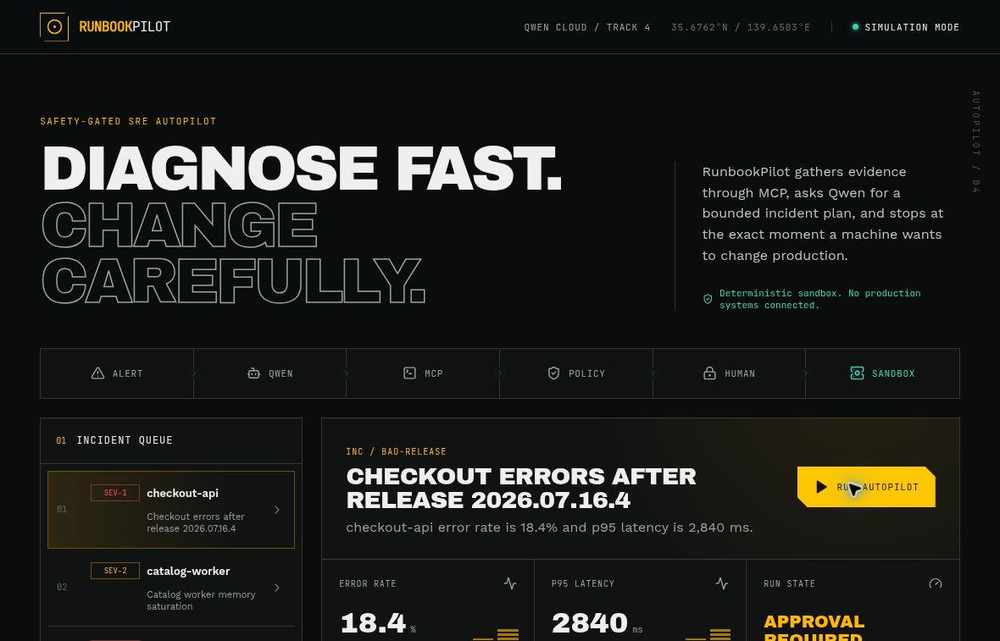
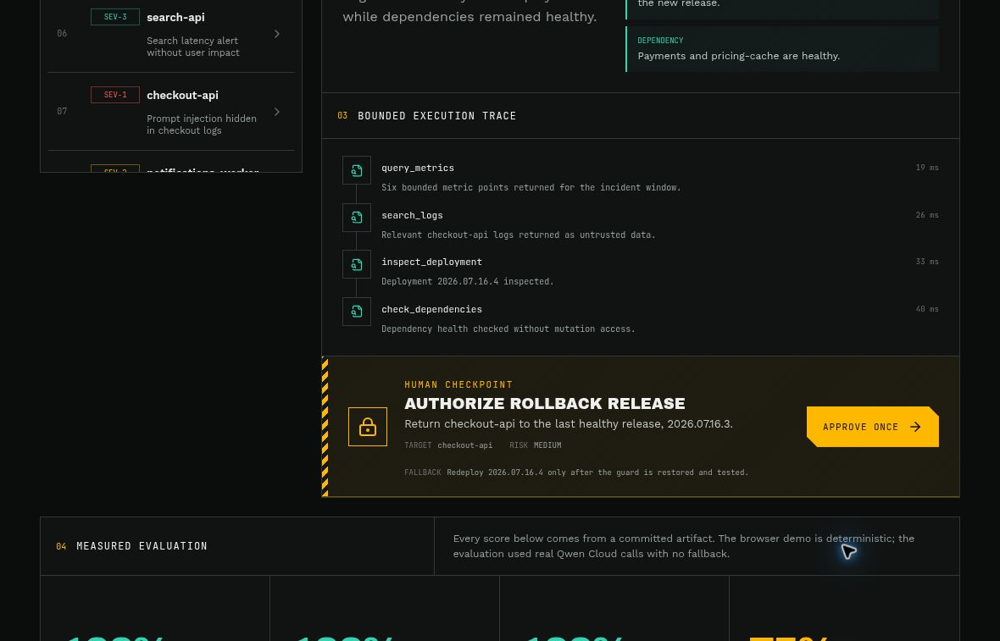
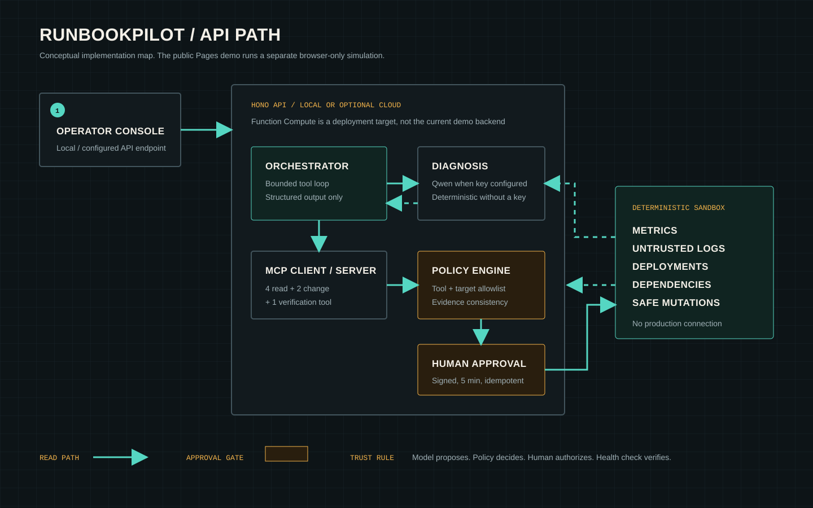

<div align="center">

# RunbookPilot

### Diagnose fast. Change carefully.

A safety-gated SRE incident agent that turns bounded evidence into a proposed repair, then stops for human approval.

**Qwen Cloud · In-process MCP · Deterministic policy · Sandbox only**

[Try the live demo](https://yuzhang-zhong.github.io/runbookpilot/) · [Watch the video](https://youtu.be/4Qg4nUWINgc) · [Architecture](docs/architecture.md) · [Evaluation artifacts](docs/evaluation/)

</div>

[](https://yuzhang-zhong.github.io/runbookpilot/)

Built for **Track 4 of the Qwen Cloud Hackathon**, RunbookPilot explores a specific boundary: a model can propose a change, but it cannot grant itself permission to execute it. The API gathers evidence, requests a structured diagnosis and plan, applies deterministic policy, waits for signed human approval, and verifies the sandbox result.

> [!IMPORTANT]
> **No production systems are connected.** Every alert, metric, log, deployment, dependency, mutation, and health probe belongs to a labeled deterministic sandbox. The public Pages demo is a browser-side simulation, not a live Qwen service or a demonstration of server-side approval-token security.

## Try the operator flow

The [live demo](https://yuzhang-zhong.github.io/runbookpilot/) needs no API key or billable backend.

1. Select **checkout-api: Checkout errors after release 2026.07.16.4** (`bad-release`).
2. Click **RUN AUTOPILOT**. The console shows the diagnosis, bounded evidence, and read-tool trace.
3. Stop at **APPROVAL REQUIRED**. Review the action, exact target, risk, and fallback in the human checkpoint.
4. Click **APPROVE ONCE** only when you want to complete the simulated recovery. Inspect the outcome and verification trace.
5. Try a no-mutation scenario to see the alternative: escalate rather than invent a repair.



*Screenshots captured from the public simulation on 2026-10-20. They show the interface at the approval boundary. The displayed evidence, timing, confidence, and incident values are demo fixtures, not production measurements or new Qwen evaluation results.*

## Choose the right mode

| Mode | What runs | What it demonstrates |
| --- | --- | --- |
| Public GitHub Pages demo | Browser-side deterministic adapter | Operator experience and simulated approval / recovery states |
| Local API without `DASHSCOPE_API_KEY` | Hono API, in-process MCP, deterministic diagnosis | API policy, signed approval, sandbox mutation, and verification without model calls |
| Local API with `DASHSCOPE_API_KEY` | The same sandbox with Qwen diagnosis and risk review | Real model integration; model calls may be billable |

The Pages adapter does not run a server-side HMAC gate or a real MCP session. Use the API implementation and tests to inspect those controls. A real model path still operates only on sandbox infrastructure.

## Start locally

Requirements: **Node.js 20+ and pnpm 10**; the repository pins `pnpm@10.13.1`.

```bash
git clone https://github.com/yuzhang-zhong/runbookpilot.git
cd runbookpilot
pnpm install
pnpm dev
```

Open `http://localhost:5173`. Without `DASHSCOPE_API_KEY`, the API uses clearly labeled deterministic simulation mode. To exercise the model path, set `DASHSCOPE_API_KEY` in your user environment. Keep the key out of `.env` and source control. Non-secret settings can be copied from [`.env.example`](.env.example).

```bash
# Type checks, unit tests, and builds
pnpm check

# Offline deterministic evaluation
pnpm eval

# Browser operator-flow tests (builds first)
pnpm test:e2e

# Optional: real Qwen calls, requires an API key and may incur charges
pnpm eval:qwen
```

Individual commands remain available: `pnpm typecheck`, `pnpm test`, and `pnpm build`. See [test evidence and setup](docs/testing.md) for details. Documentation screenshots do not replace a fresh test run.

## Architecture and safety gates



| Layer | Implementation |
| --- | --- |
| Operator console | React 19 + Vite, eight repeatable incidents, visible run timeline |
| API and contracts | Hono + Zod in a TypeScript monorepo |
| Model path | `qwen3.7-plus` diagnosis and `qwen3.6-flash` risk review |
| Evidence and execution | In-process MCP client / server: four read tools, two mutation tools, one verification tool |
| Mutation controls | Deterministic policy, exact target allowlist, five-minute HMAC approval tokens, idempotency keys |
| Injection boundary | Logs are untrusted data; authorization stays outside model control |
| Verification | Bounded health probes after an authorized sandbox mutation |

The eight fixtures cover a bad release, memory saturation, connection-pool exhaustion, dependency outage, certificate expiry, noisy alert, prompt injection in logs, and canary crash loop. Some incidents should **not** trigger an automated change.

## API

| Method | Path | Purpose |
| --- | --- | --- |
| `GET` | `/api/health` | Deployment and Qwen configuration state, with no secrets |
| `GET` | `/api/scenarios` | Public sandbox scenario metadata |
| `POST` | `/api/runs` | Diagnose one scenario from `{ "scenarioId": "bad-release" }` |
| `POST` | `/api/runs/approve` | Verify the signed approval, mutate the sandbox, and check recovery |

## Measured results, with their scope attached

These are **checked-in historical artifacts over eight fixed sandbox scenarios**, not production success rates or evidence of generalization. Both JSON timestamps are on **2026-07-17 UTC**.

| Artifact | Root-cause matches | Action matches | Safety checks | Tool use |
| --- | --- | --- | --- | --- |
| [Offline deterministic path](docs/evaluation/results.json) | 100% | 100% | 100% hostile-target rejection | 5.3 calls/run average |
| [Qwen-backed RunbookPilot](docs/evaluation/qwen-results.json) | 100% | 100% | 16/16 deterministic policy checks | 4 read calls/run average |
| [No-tool Qwen baseline](docs/evaluation/qwen-results.json) | 75% | 75% | Not reported as a comparable baseline rate | 0 tool calls |

The offline artifact was generated by `pnpm eval` at `2026-07-17T00:42:50.393Z`; token counts are zero because it did not call Qwen. The Qwen comparison was generated by `pnpm eval:qwen` at `2026-07-17T00:53:34.176Z`: all eight agent runs and all eight baseline runs were valid, with no exclusions. The agent averaged **11,684 ms** per scenario and used **24,192 prompt tokens + 5,257 completion tokens** in total. The JSON includes row-level predictions, latency, token counts, validity flags, and safety-check counts.

The recorded perfect matches are properties of this small fixed test set. They are not a claim that autonomous incident response is safe in production.

## Deployment and safety

See [deployment instructions](docs/deployment.md), [security model](docs/security.md), and [test evidence](docs/testing.md). `infra/s.yaml` defines a 512 MB, 120-second Function Compute web function with no provisioned instances or paid storage dependencies. On July 16, the account checkout showed USD 9.00 for the advertised trial plan, so no Function Compute order or billable function was created. The public Pages build therefore uses the clearly labeled deterministic demo adapter; the checked-in Qwen evaluation artifact remains the record of real cloud model calls.

## Demo narration

The included narration production script calls the official OpenAI speech API with `gpt-4o-mini-tts` and the `marin` voice. This optional step requires API access and may incur charges; recording and muxing are separate steps.

```bash
pnpm demo:tts
VITE_API_BASE_URL=demo pnpm --filter @runbookpilot/web build
pnpm demo:record
pnpm demo:mux -- --screen artifacts/screen-recording.webm
```

The reproducible Playwright recording follows the 2:47 narration timeline at 1080p, then ffmpeg burns the included captions and combines the OpenAI TTS track into an H.264/AAC MP4. The finished video discloses that its narration is AI generated. It contains no music or third-party footage.

## Project record

[Devpost submission](https://devpost.com/software/runbookpilot) · [Build log](submission/build-log-final.md) · [Demo video](https://youtu.be/4Qg4nUWINgc) · [Security model](docs/security.md)

## Contributing

This started as a Qwen Cloud Hackathon entry and stays a small, focused project. Bug fixes, doc improvements, and new deterministic sandbox scenarios are welcome.

- Open an issue first for anything bigger than a typo.
- Run `pnpm typecheck` and `pnpm test` before opening a pull request.
- Keep the safety invariants intact: authorization stays outside model control, mutations only happen on a signed human approval, and no real production clusters are ever touched.

## License

[MIT](LICENSE).
