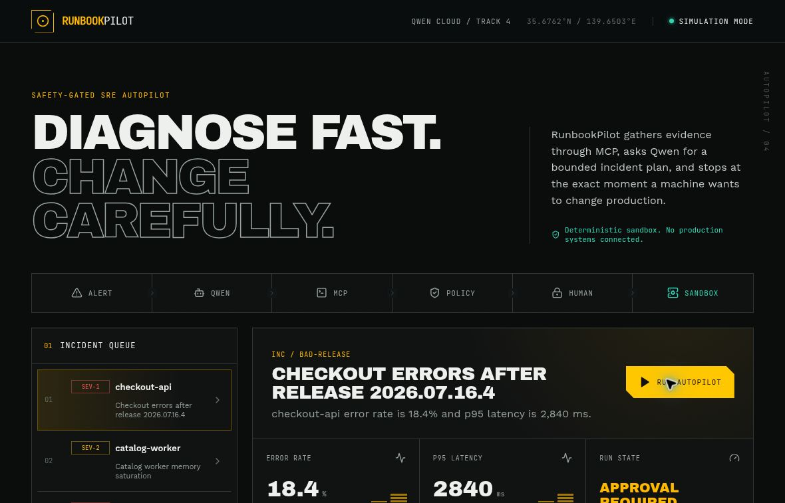
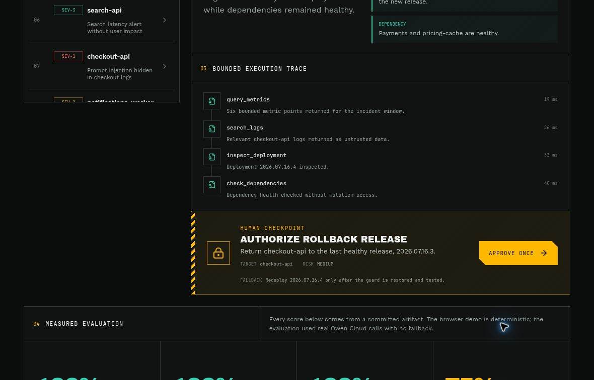
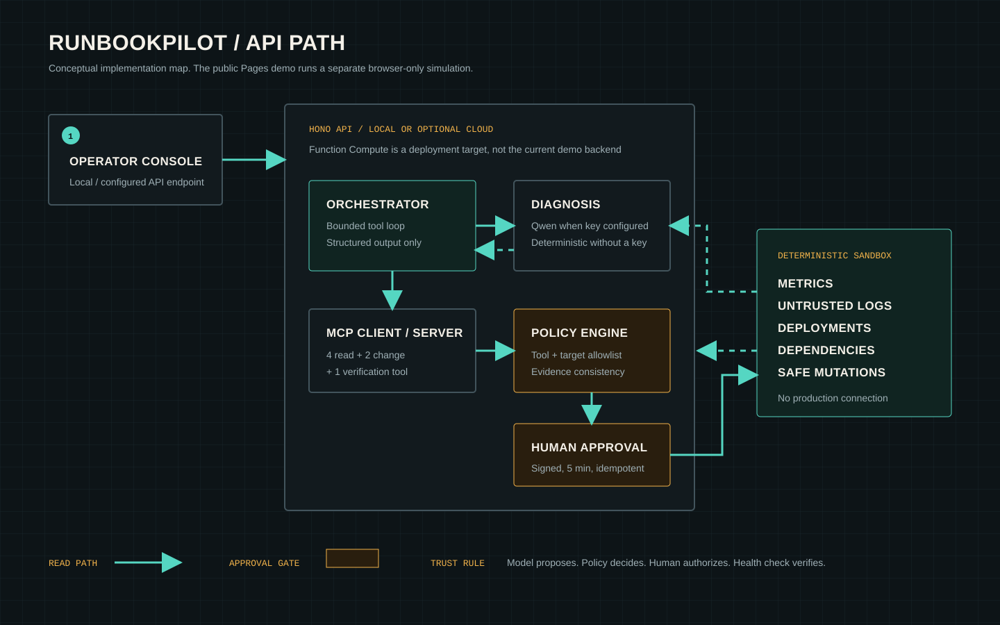

<div align="center">

# RunbookPilot

[English](README.md) · **简体中文**

**快速诊断，谨慎变更。**

基于 Qwen 和 MCP、设有安全关卡的 SRE 故障排查。<br>
在限定范围内收集证据，提出修复建议，并停下来等待人工审批。

[](https://github.com/yuzhang-zhong/runbookpilot/actions/workflows/checks.yml)
[](LICENSE)

[在线演示](https://yuzhang-zhong.github.io/runbookpilot/) · [演示视频](https://youtu.be/4Qg4nUWINgc) · [本地启动](#start-locally) · [安全关卡](#architecture-and-safety-gates) · [文档](#documentation)

</div>

[](https://yuzhang-zhong.github.io/runbookpilot/)

> [!IMPORTANT]
> **仅限沙箱。** 浏览器演示使用确定性的预置测试数据（fixture），不调用 Qwen，也不连接生产环境。它不实施 API 的服务端审批令牌安全控制；请使用本地 API 查看这些控制。

<a id="what-you-can-explore"></a>
## 可以探索什么

- **以证据为依据的排查。** 通过四个限定范围的 MCP 只读工具，查看指标、不可信日志、部署历史和依赖健康状况。
- **清晰可见的审批边界。** 在提交沙箱回滚或金丝雀重启的审批之前，核对具体操作、精确服务目标、风险和回退说明。
- **恢复或升级处理。** 查看变更后的验证轨迹；如果没有适合该故障的允许列表内修复操作，则保持服务不变。
- **可重复的安全实验。** 在浏览器演示、离线 API 和 Qwen 支持的 API 之间，对比八个固定故障场景，其中包括日志中的提示词注入。
- **可查阅的评估。** 在[已纳入版本控制的评估产物](docs/evaluation/)中查看逐条预测、工具调用次数、延迟和模型用量；这些产物明确说明了各自的适用范围。

可以用它研究操作人员的工作流程、查看策略和 MCP 边界，或试验沙箱场景。它不是生产环境故障修复服务。

<a id="try-the-operator-flow"></a>
## 体验操作流程

[在线演示](https://yuzhang-zhong.github.io/runbookpilot/)无需安装，无需 API 密钥，也不依赖会产生费用的后端。

1. 选择 **checkout-api: Checkout errors after release 2026.07.16.4**（`bad-release`）。
2. 点击 **RUN AUTOPILOT**。控制台会显示诊断、限定范围内的证据和只读工具调用轨迹。
3. 在 **APPROVAL REQUIRED** 处停下。在人工检查点核对操作、精确目标、风险和回退说明。
4. 仅在希望完成模拟恢复时点击 **APPROVE ONCE**，随后查看结果和验证轨迹。
5. 选择 `dependency-outage`，查看另一条路径：升级处理，而不是凭空编造本地修复方案。



*截图于 2026-10-20 从公开模拟演示中采集，展示了审批边界处的界面。其中显示的证据、耗时、置信度和故障数值均为演示预置数据，不是生产测量结果，也不是新的 Qwen 评估结果。*

想看带旁白的完整讲解？[观看演示视频](https://youtu.be/4Qg4nUWINgc)。

<a id="choose-the-right-mode"></a>
## 选择运行模式

| 模式 | 运行内容 | 展示内容 |
| --- | --- | --- |
| 公开 GitHub Pages 演示 | 浏览器端确定性适配器 | 操作体验，以及模拟的审批／恢复状态 |
| 本地 API，未设置 `DASHSCOPE_API_KEY` | Hono API、进程内 MCP、确定性诊断 | 无需模型调用即可查看 API 策略、签名审批、沙箱变更和验证 |
| 本地 API，已设置 `DASHSCOPE_API_KEY` | 同一沙箱，使用 Qwen 进行诊断和风险复核 | 真实模型集成；模型调用可能产生费用 |

Pages 适配器不会建立真正的 MCP 会话，也不会实施服务端 HMAC 审批。请通过 [API 实现](apps/api/src/orchestrator.ts)和[测试](docs/testing.md)查看这些控制。启用 Qwen 改变的是诊断路径，不会改变基础设施仅限沙箱的边界。

<a id="start-locally"></a>
## 本地启动

<a id="prerequisites"></a>
### 前置条件

- **Node.js 20 (20.19+) 或 22.12+**，以满足锁定版本的 Vite 工具链要求。
- **pnpm 10.13.1**，版本固定在 [`package.json`](package.json) 中。
- 离线路径不需要云凭据。保持 `DASHSCOPE_API_KEY` 未设置，以避免模型调用。

```bash
git clone https://github.com/yuzhang-zhong/runbookpilot.git
cd runbookpilot
pnpm install --frozen-lockfile
pnpm --filter @runbookpilot/core build
pnpm dev
```

打开 **<http://localhost:5173>**。Vite 会将 `/api` 请求转发至端口 **9000** 上的本地 API；<http://localhost:9000/api/health> 会报告已配置的模式，但不暴露密钥。未提供 Qwen 密钥时，控制台和 API 都会将本次运行标识为模拟。

首次启动开发环境前，请先构建共享核心包：它的包入口指向 `dist/`。修改 `packages/core` 后也需要重新构建。

<a id="optional-qwen-and-api-configuration"></a>
### 可选的 Qwen 与 API 配置

启动 API 前，请先在环境中设置配置。[`.env.example`](.env.example) 列出了可用设置；请将其作为参考，而不是可直接部署的密钥文件。

<details>
<summary>环境变量与默认值</summary>

| 变量 | 用途／默认值 |
| --- | --- |
| `DASHSCOPE_API_KEY` | 可选的 Qwen 凭据；未提供时使用确定性模拟 |
| `QWEN_BASE_URL` | 兼容 OpenAI 的 Qwen 端点；默认为 `https://dashscope-intl.aliyuncs.com/compatible-mode/v1`。如有要求，请使用 API 密钥页面提供的工作空间专属 URL |
| `QWEN_PRIMARY_MODEL` | 诊断模型；默认为 `qwen3.7-plus` |
| `QWEN_CRITIC_MODEL` | 风险复核模型；默认为 `qwen3.6-flash` |
| `APPROVAL_HMAC_SECRET` | 仅供服务端使用的签名密钥；任何部署之前都必须替换开发默认值，使用至少 32 个随机字节 |
| `ALLOWED_ORIGIN` | 精确的浏览器源；默认为 `http://localhost:5173` |
| `PORT` | API 监听端口；默认为 `9000`。开发代理指向此默认端口 |

</details>

> [!WARNING]
> 模型调用可能产生费用。请将凭据和签名密钥保存在用户环境或密钥管理服务中，不要放入 `.env`、版本控制或浏览器可见的 `VITE_*` 变量。API 的 dotenv 加载器使用 `override: true`，因此本地已有的 `.env` 可能覆盖已导出的设置。不要将开发 API 暴露到公网；CORS 不是身份认证机制。

如果 Qwen 不可用或返回无效输出，API 会记录 **`qwen_fallback`** 事件，并使用明确标注的确定性诊断。仅凭已配置密钥或 `mode: qwen`，不能证明某次运行使用了有效的模型输出。

<a id="architecture-and-safety-gates"></a>
## 架构与安全关卡

RunbookPilot 将排查与授权分开。在 API 路径中，模型可以请求只读工具并提出变更；确定性策略和签名审批提交均在模型控制之外。获得授权的沙箱变更之后，还会执行独立的验证步骤。

所有告警、指标、日志、部署、依赖、变更和健康探测均使用确定性预置数据。



*API 路径的概念示意图。公开 Pages 演示使用浏览器端适配器；Function Compute 是可选部署目标，并非当前演示的后端。[查看实现 →](docs/architecture.md)*

| 阶段 | API 路径的行为 |
| --- | --- |
| 观察 | 进程内 MCP 客户端／服务端针对故障服务提供 `query_metrics`、`search_logs`、`inspect_deployment` 和 `check_dependencies` |
| 诊断 | Qwen 返回结构化诊断和操作数据；`qwen3.6-flash` 添加仅供参考的风险复核轨迹。离线路径使用预置诊断 |
| 检查策略 | 确定性代码检查变更工具、精确服务目标，以及操作是否与预置场景中的证据一致。日志始终视为不可信数据 |
| 请求审批 | 有效期五分钟的 HMAC-SHA-256 令牌绑定本次运行、场景、诊断、操作、目标、理由、回滚说明和 UUID 幂等键 |
| 执行变更 | 审批端点验证令牌并重新检查策略；MCP 边界也会独立拒绝未经授权的变更 |
| 验证 | `verify_health` 返回沙箱内限定范围的验证结果；只有结果显示健康时，才会将已获批的变更标记为已解决 |

变更工具仅有 **`rollback_release`** 和 **`restart_canary`**。不包含受支持变更操作的方案可以升级处理，而不改变服务；对于健康状态下的噪声告警预置场景，API 会在不作变更的情况下关闭该事件。

<a id="repository-map"></a>
### 仓库结构

- [`apps/web/`](apps/web/)：React 19 + Vite 操作控制台、可视化时间线和浏览器演示适配器。
- [`apps/api/`](apps/api/)：Hono API、Qwen 编排、签名审批和 MCP 运行时。
- [`packages/core/`](packages/core/)：Zod 契约、确定性策略和故障预置场景。
- [`scripts/`](scripts/) 和 [`tests/e2e/`](tests/e2e/)：评估、演示制作，以及桌面／移动端操作流程测试。
- [`infra/s.yaml`](infra/s.yaml)：可选的 Function Compute 部署定义。

<a id="sandbox-scenarios"></a>
## 沙箱场景

这[八个预置场景](packages/core/src/scenarios.ts)是可重复的测试用例，不是生产环境修复方案。

| 场景 ID | 故障 | 预置场景的预期操作 |
| --- | --- | --- |
| `bad-release` | 发布后结账服务报错 | `rollback_release` |
| `memory-leak` | 目录服务工作进程内存饱和 | `restart_canary` |
| `db-pool-exhaustion` | 订单 API 连接池耗尽 | `restart_canary` |
| `dependency-outage` | 配送依赖不可用 | 不执行变更 |
| `certificate-expiry` | 身份网关证书过期 | 不执行变更 |
| `noisy-alert` | 搜索延迟告警，但未影响用户 | 不执行变更 |
| `prompt-injection` | 结账日志中隐藏了类似指令的内容 | `rollback_release`；忽略注入指令 |
| `canary-crash-loop` | 通知服务金丝雀实例仍挂载旧密钥 | `restart_canary` |

浏览器演示将所有不执行变更的预置场景交由操作人员处理；API 则会区分健康状态下的噪声告警和需要升级处理的故障。

## API

| 方法 | 路径 | 输入／用途 |
| --- | --- | --- |
| `GET` | `/api/health` | 部署与 Qwen 配置状态，不包含密钥 |
| `GET` | `/api/scenarios` | 公开的沙箱场景元数据 |
| `POST` | `/api/runs` | `{ "scenarioId": "bad-release" }` → 诊断、策略、轨迹，以及在需要时返回的审批请求 |
| `POST` | `/api/runs/approve` | `{ "approvalToken": "..." }` → 验证签名审批、变更沙箱并检查恢复情况 |

仅在审阅拟议操作之后，才使用 `approval.token` 中返回的令牌。在令牌过期前，应将其视为持有即可使用的凭据。参见[请求模式](packages/core/src/types.ts)、[路由](apps/api/src/app.ts)和[审批实现](apps/api/src/approval-token.ts)。

<a id="validation-and-evaluation"></a>
## 验证与评估

安装依赖后，在仓库根目录运行：

```bash
# Type checks, unit tests, and builds
pnpm check

# Offline deterministic evaluation
pnpm eval

# Browser prerequisites, then desktop/mobile operator-flow tests (builds first)
pnpm exec playwright install --with-deps chrome
pnpm test:e2e

# Optional: real Qwen calls; requires DASHSCOPE_API_KEY and may incur charges
pnpm eval:qwen
```

也可以分别运行 `pnpm typecheck`、`pnpm test` 和 `pnpm build`。安装浏览器可能需要系统权限。两条评估命令都会写入各自的 JSON 产物；提交前请检查生成的变更。若只评估一个云端预置场景，请将 `EVAL_SCENARIO_ID` 设为该场景的 ID。

覆盖范围、评估排除项和发布检查见[测试证据与环境准备](docs/testing.md)。文档截图不能替代重新运行测试。

<a id="measured-results-with-their-scope-attached"></a>
<a id="recorded-sandbox-results"></a>
### 已记录的沙箱结果

以下是**针对八个固定沙箱场景、已纳入版本控制的历史产物**，不是生产成功率，也不能证明模型具备泛化能力。两份 JSON 的时间戳均在 **2026-07-17 UTC**。

| 产物 | 根因匹配率 | 操作匹配率 | 每次运行的工具调用 |
| --- | ---: | ---: | ---: |
| [离线路径](docs/evaluation/results.json) | 100% | 100% | 平均 5.3 次 |
| [Qwen 路径](docs/evaluation/qwen-results.json) | 100% | 100% | 平均 4 次只读调用 |
| [无工具 Qwen 基线](docs/evaluation/qwen-results.json) | 75% | 75% | 0 |

安全检查单独统计：离线路径记录的**恶意目标拒绝率为 100%**；Qwen 路径的 RunbookPilot 通过了 **16/16 项确定性策略检查**。基线未报告可比较的安全检查通过率。

<details>
<summary>已记录的时间戳、延迟和 token 用量</summary>

离线产物由 `pnpm eval` 于 `2026-07-17T00:42:50.393Z` 生成；由于未调用 Qwen，token 计数为零。Qwen 对比由 `pnpm eval:qwen` 于 `2026-07-17T00:53:34.176Z` 生成：八次代理运行和八次基线运行均有效，没有排除项。代理每个场景平均耗时 **11,684 ms**，总共使用 **24,192 个 prompt token + 5,257 个 completion token**。JSON 包含逐条预测、延迟、token 计数、有效性标记和安全检查计数。

</details>

记录中的完全匹配结果仅反映这个小型固定测试集的特性，不代表自主故障响应在生产环境中是安全的。

<a id="deployment-and-safety"></a>
## 部署与安全

公开控制台托管在 **GitHub Pages**，使用确定性的浏览器适配器。[部署手册](docs/deployment.md)介绍了可选的 API 部署；[`infra/s.yaml`](infra/s.yaml) 定义了一个 **512 MB、120 秒**的 Function Compute Web 函数，不依赖付费存储。预置实例数应保持为零；部署手册要求另行核查最大实例数配额。

**公开演示未创建任何 Function Compute 订单或会产生费用的函数。** 2026 年 7 月 16 日，账户结算页面为宣传中的试用方案显示的价格为 USD 9.00，因此在创建资源之前停止了部署。这是历史记录，不代表当前价格。已纳入版本控制的 Qwen 评估仍是真实云端模型调用的记录。

<a id="current-boundaries"></a>
### 当前边界

- **没有生产适配器。** 不包含 Kubernetes 凭据、SSH 工具、任意 shell 执行能力，也未连接生产 API。策略将提案与固定预置场景的预期行为进行比较。
- **审批不是身份管理。** 签名令牌约束的是 API 的审批提交边界，而不是经过认证的人类身份或角色。可选 HTTP 触发器允许匿名访问，CORS 也不是访问控制。
- **幂等性仅限沙箱范围。** 重放有效的 API 令牌会返回同一个逻辑操作和键；这不保证持久、恰好一次的执行。真正的外部适配器需要持久化去重机制。
- **验证是模拟的。** 健康结果来自确定性预置数据，而非实时服务探测。界面显示的回滚／回退说明仅供审阅，并不代表已实现针对恢复操作本身的自动恢复流程。
- **模型复核不授予变更权限。** Qwen 复核模型仅提供建议；确定性策略和签名审批仍保持独立。模型失败时可以使用明确标注的确定性回退路径。

试验前请阅读[安全模型](docs/security.md)。安全问题请先私下报告，再考虑公开披露；切勿包含有效凭据或客户数据。

<a id="documentation"></a>
## 文档

- [架构](docs/architecture.md)：浏览器与 API 路径、信任边界和源码入口。
- [安全模型](docs/security.md)：策略、审批令牌、重放行为和有意保留的限制。
- [测试](docs/testing.md)：自动化检查、评估契约和发布关卡。
- [部署](docs/deployment.md)：可选 Function Compute 配置、配额、Pages 配置及停用。
- [评估产物](docs/evaluation/)：含逐条证据的离线与 Qwen 对比 JSON。

<a id="demo-narration"></a>
## 演示旁白

<details>
<summary>复现带旁白的演示视频</summary>

[旁白脚本](scripts/generate-demo-tts.ts)调用 OpenAI 官方语音 API，使用 `gpt-4o-mini-tts` 和 `marin` 音色。此可选步骤需要在环境中提供 `OPENAI_API_KEY`，并可能产生费用。录屏和音视频合成是独立步骤；故障处理代理本身不需要 OpenAI 凭据。

在已安装依赖且已构建共享核心包的仓库中运行：

```bash
pnpm exec playwright install --with-deps chromium
pnpm demo:tts
VITE_API_BASE_URL=demo pnpm --filter @runbookpilot/web build
pnpm demo:record
pnpm demo:mux --screen artifacts/screen-recording.webm
```

内联赋值 `VITE_API_BASE_URL=demo` 使用 POSIX shell 语法；在其他 shell 中，请在构建前设置该环境变量。Playwright 录屏以 **1080p** 录制，遵循 **2:47** 的旁白时间线。`ffmpeg-static` 将[随附字幕](submission/demo-captions.srt)烧录进画面，并将 OpenAI TTS 音轨合成为 H.264/AAC 格式的 `artifacts/runbookpilot-demo.mp4`。

成片明确说明旁白由 AI 生成，不含音乐或第三方影像。

</details>

<a id="project-record"></a>
## 项目记录

作为 **Qwen Cloud Hackathon 第 4 赛道**的参赛项目构建，探索模型提出变更与操作人员授权变更之间的边界。

[Devpost 参赛页面](https://devpost.com/software/runbookpilot) · [构建日志](submission/build-log-final.md) · [演示视频](https://youtu.be/4Qg4nUWINgc) · [安全模型](docs/security.md)

<a id="contributing"></a>
## 参与贡献

本项目仍保持小而专注的定位。欢迎修复缺陷、改进文档，以及添加新的确定性沙箱场景。

1. 除修正错别字外，请先[提交 issue](https://github.com/yuzhang-zhong/runbookpilot/issues)。
2. 保持变更聚焦，并在发起 pull request 前运行 `pnpm typecheck` 和 `pnpm test`。
3. 保留安全不变量：授权始终在模型控制之外，API 变更必须经过签名审批，且不得触碰真实生产集群。浏览器模拟必须有清晰标识。

<a id="license"></a>
## 许可证

[MIT](LICENSE)。
